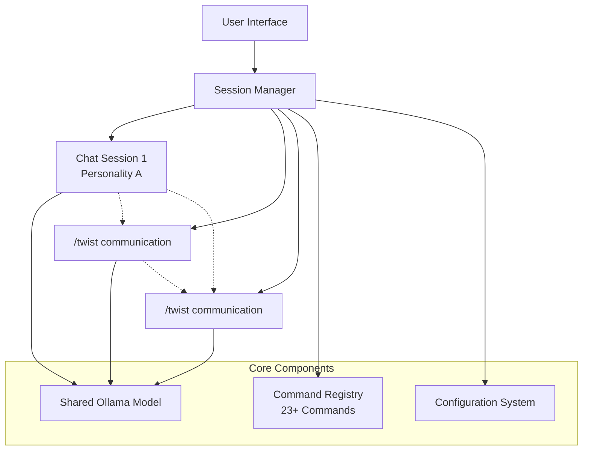
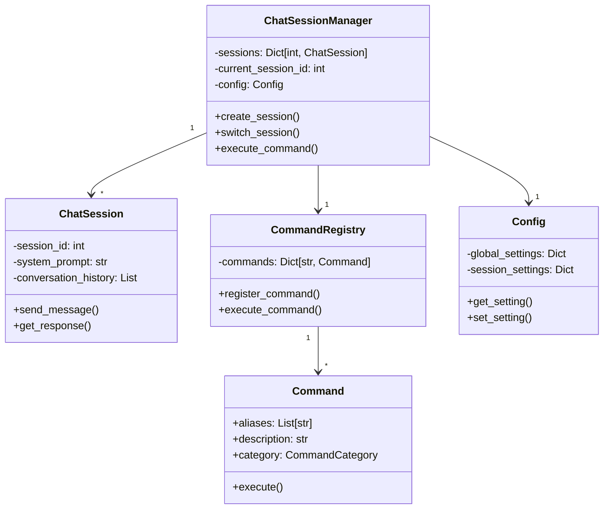
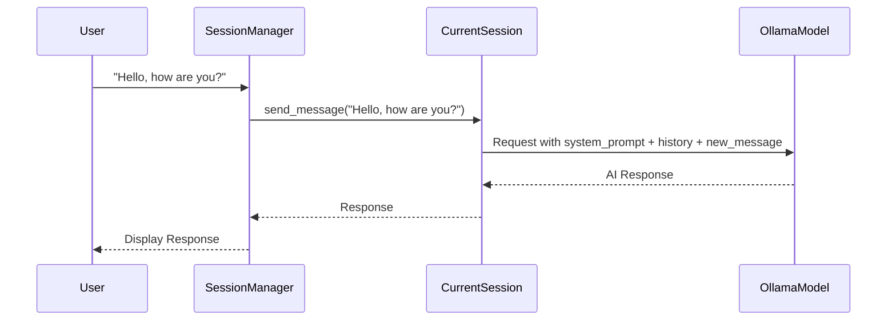
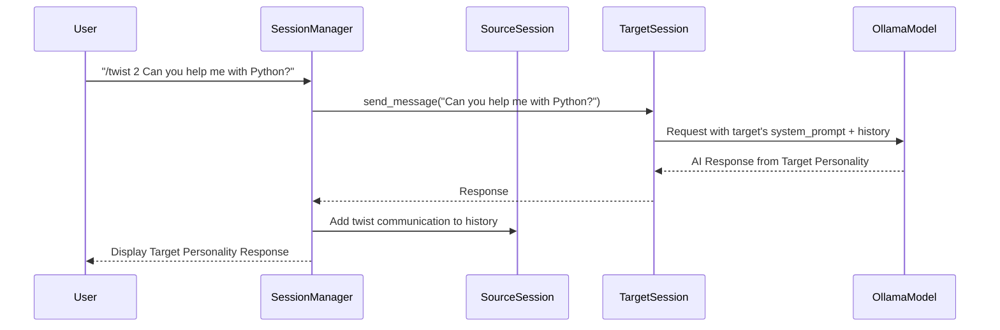
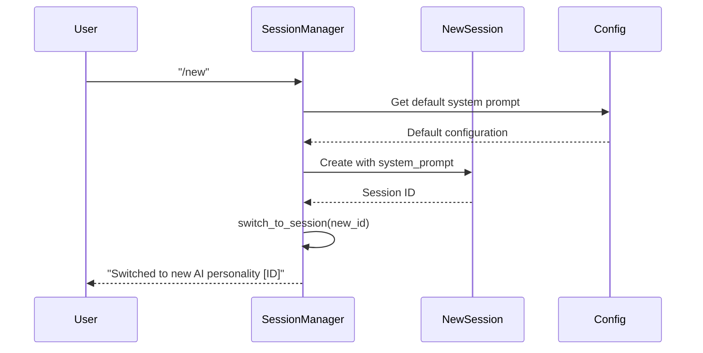

# HiOllama Architecture

> **Technical Deep Dive: Multi-Personality AI Communication System**

This document provides a comprehensive technical overview of HiOllama's architecture, designed to enable multiple AI personalities that can communicate and collaborate with each other using a single Ollama model.

## 🎯 Core Architectural Principle

HiOllama implements a **paradigm shift** from traditional single-context AI chat to a **multi-personality ecosystem**. The key innovation is creating isolated AI personalities through unique system prompts and conversation histories, while enabling cross-personality communication via the `/twist` command.

## 🏗️ System Architecture

### High-Level Overview



### Component Relationships



## 🔧 Core Components

### 1. ChatSessionManager (`session_manager.py`)

**Purpose**: Orchestrates multiple AI personalities and manages inter-personality communication.

**Key Responsibilities**:
- **Session Lifecycle**: Create, switch, and manage multiple chat sessions
- **Command Routing**: Process user commands and route to appropriate handlers
- **Cross-Session Communication**: Enable `/twist` functionality between personalities
- **Global State Management**: Maintain current session and shared configuration

**Core Methods**:
```python
class ChatSessionManager:
    def create_session(self, system_prompt: str = None) -> int:
        """Creates a new AI personality with optional system prompt"""
        
    def switch_session(self, session_id: int) -> bool:
        """Switches to a different AI personality"""
        
    def twist_message(self, target_session: int, message: str) -> CommandResult:
        """Sends message from current personality to target personality"""
        
    def execute_command(self, command_text: str) -> CommandResult:
        """Processes and executes user commands"""
```

### 2. ChatSession (`app.py`)

**Purpose**: Represents an individual AI personality with isolated context.

**Key Responsibilities**:
- **Conversation Management**: Maintain conversation history for the personality
- **System Prompt Handling**: Define the AI's role and behavior
- **Model Interaction**: Interface with the shared Ollama model
- **Context Isolation**: Ensure personalities don't interfere with each other

**Core Methods**:
```python
class ChatSession:
    def send_message(self, message: str) -> str:
        """Sends user message and gets AI response from this personality"""
        
    def set_system_prompt(self, prompt: str):
        """Updates the personality's system prompt/role definition"""
        
    def clear_history(self):
        """Resets conversation while preserving personality"""
```

### 3. Command Registry (`commands/__init__.py`)

**Purpose**: Extensible system for managing all user commands.

**Architecture Pattern**: Registry Pattern for dynamic command registration

**Command Categories**:
- **CORE**: Essential chat operations (`/new`, `/switch`, `/list`)
- **COMMUNICATION**: Inter-personality features (`/twist`, `/copy`)
- **SESSION**: Session management (`/save`, `/load`, `/export`)
- **MODEL**: Model configuration (`/model`, `/system`, `/config`)
- **INFO**: Information and help (`/status`, `/help`, `/debug`)
- **ADVANCED**: Power user features (`/history`, `/search`)

**Registration Example**:
```python
@register_command
class TwistCommand(Command):
    aliases = ["twist", "tw"]
    description = "Send message to another AI personality"
    category = CommandCategory.COMMUNICATION
    
    def execute(self, args: str, session_manager: ChatSessionManager) -> CommandResult:
        # Parse target session and message
        # Route message to target personality
        # Return cross-personality response
```

### 4. Configuration System (`config.py`)

**Purpose**: Unified configuration management for global and per-session settings.

**Configuration Hierarchy**:
```yaml
global:
  model: "llama2"
  ollama_url: "http://localhost:11434"
  max_history: 100
  
sessions:
  0:
    system_prompt: "You are a helpful assistant"
    temperature: 0.7
  1:
    system_prompt: "You are a Python expert"
    temperature: 0.3
```

**Key Features**:
- **Global Settings**: Model selection, Ollama connection, default parameters
- **Per-Session Settings**: Individual personality configurations
- **Inheritance**: Sessions inherit global settings unless overridden
- **Persistence**: Save/load configurations across application restarts

### 5. Model Interaction Layer (`model_interaction.py`)

**Purpose**: Abstract interface to Ollama API with shared model management.

**Key Design Decision**: **Single Model, Multiple Contexts**
- One Ollama model serves all AI personalities
- Context switching achieved through system prompts and conversation histories
- Model changes affect all personalities immediately
- Optimized for memory efficiency and response consistency

**Core Interface**:
```python
class ModelInteraction:
    def send_message(self, prompt: str, system_prompt: str, history: List) -> str:
        """Send message to Ollama with personality context"""
        
    def get_available_models() -> List[str]:
        """List all available Ollama models"""
        
    def set_model(self, model_name: str) -> bool:
        """Switch the global model (affects all personalities)"""
```

### 6. Type System (`types.py`)

**Purpose**: Define command structure and result handling.

**Key Types**:
```python
class CommandCategory(Enum):
    CORE = "core"
    COMMUNICATION = "communication"
    SESSION = "session"
    MODEL = "model"
    INFO = "info"
    ADVANCED = "advanced"

class CommandResult:
    success: bool
    message: str
    data: Optional[Dict]
    
    @classmethod
    def success(cls, message: str, data: Dict = None) -> 'CommandResult'
    
    @classmethod
    def error(cls, message: str) -> 'CommandResult'
```

### 7. User Interface Layer

**Purpose**: Provide intuitive command-line interface for multi-personality interaction.

**Key Features**:
- **Rich Text Formatting**: Color-coded responses and status indicators
- **Session Awareness**: Display current AI personality in prompt
- **Command Completion**: Auto-suggest available commands
- **Error Handling**: Clear feedback for invalid commands or system errors

## 🔄 Data Flow and Communication

### Standard Message Flow



### Cross-Personality Communication Flow (`/twist`)



### Session Creation and Management



## 🎨 Design Patterns

### 1. Registry Pattern (Commands)
**Use Case**: Dynamic command registration and execution
**Benefits**: Easy extensibility, loose coupling, runtime command discovery

```python
# Commands self-register using decorators
@register_command
class NewCommand(Command):
    # Command implementation
```

### 2. Strategy Pattern (Model Interaction)
**Use Case**: Abstract different AI model backends
**Benefits**: Model-agnostic design, easy provider switching

### 3. Observer Pattern (Session Events)
**Use Case**: React to session changes and command execution
**Benefits**: Decoupled event handling, extensible notification system

### 4. Composition over Inheritance
**Use Case**: Building complex commands from simple operations
**Benefits**: Flexible command composition, reusable components

## 🔧 Extensibility

### Adding New Commands

1. **Create Command Class**:
```python
@register_command
class YourCommand(Command):
    aliases = ["your", "cmd"]
    description = "Description of your command"
    category = CommandCategory.ADVANCED
    
    def execute(self, args: str, session_manager: ChatSessionManager) -> CommandResult:
        # Your implementation
        return CommandResult.success("Command executed!")
```

2. **Command Registration**: Automatic via `@register_command` decorator

3. **Integration**: Commands automatically appear in `/help` and are available immediately

### Adding New ActionTypes

```python
class ActionType(Enum):
    # Existing actions...
    YOUR_CUSTOM_ACTION = "your_custom_action"
```

### Extending Configuration

```python
# In config.py
def add_custom_setting(self, key: str, value: Any, session_id: int = None):
    """Add custom configuration option"""
    if session_id is None:
        self.global_settings[key] = value
    else:
        self.session_settings[session_id][key] = value
```

## 🚀 Performance Considerations

### Memory Management
- **Conversation History Limits**: Configurable max history per session
- **Session Cleanup**: Automatic cleanup of inactive sessions
- **Model Sharing**: Single model instance serves all personalities

### Response Time Optimization
- **Context Caching**: Cache system prompts and common patterns
- **Async Processing**: Non-blocking command execution where possible
- **Efficient History Management**: Sliding window for large conversations

### Scalability
- **Session Limits**: Configurable maximum concurrent sessions
- **Resource Monitoring**: Track memory and CPU usage per session
- **Graceful Degradation**: Handle model unavailability gracefully

## 🛡️ Error Handling

### Command Validation
```python
def validate_command(self, command: str, args: str) -> bool:
    """Validate command syntax and arguments"""
    # Validation logic
    return True
```

### Model Error Recovery
- **Connection Failures**: Retry logic with exponential backoff
- **Invalid Responses**: Fallback to previous working configuration
- **Resource Exhaustion**: Queue management and request throttling

### Session State Recovery
- **Corrupted Sessions**: Automatic session recreation
- **Configuration Errors**: Reset to default settings
- **History Corruption**: Selective history repair

## 📊 Current Limitations

### Technical Constraints
1. **Global Model Only**: All personalities share the same Ollama model
   - **Impact**: Cannot use specialized models per personality
   - **Workaround**: Carefully crafted system prompts for specialization

2. **Memory Limitations**: Large conversation histories may impact performance
   - **Impact**: Slower responses with extensive chat history
   - **Mitigation**: Configurable history limits and automatic cleanup

3. **Sequential Processing**: Commands processed one at a time
   - **Impact**: No parallel personality interactions
   - **Future**: Async command processing planned

### Functional Limitations
1. **No Persistent Relationships**: Personalities don't remember previous `/twist` interactions
2. **Basic Authentication**: No user authentication or session isolation
3. **Limited File Operations**: No direct file sharing between personalities

## 🔮 Future Architecture Evolution

### Planned Enhancements

1. **Multi-Model Support**:
   ```python
   class PersonalityConfig:
       model: str  # Each personality could have its own model
       system_prompt: str
       parameters: Dict
   ```

2. **Persistent Personality Relationships**:
   ```python
   class PersonalityRelationship:
       source_id: int
       target_id: int
       interaction_history: List[TwistMessage]
       relationship_context: str
   ```

3. **Advanced Communication Protocols**:
   - File sharing between personalities
   - Rich media exchange (images, documents)
   - Group conversations (multiple personalities in one thread)

4. **Distributed Architecture**:
   - Multi-user support
   - Cloud-based personality hosting
   - Personality marketplaces

## 🧪 Testing Strategy

### Unit Testing
- **Command Testing**: Individual command functionality
- **Session Management**: Session creation, switching, deletion
- **Configuration**: Setting persistence and inheritance

### Integration Testing
- **Model Interaction**: End-to-end Ollama communication
- **Cross-Session Communication**: `/twist` functionality
- **Command Pipeline**: Complete command execution flow

### Performance Testing
- **Memory Usage**: Multiple active sessions
- **Response Times**: Large conversation histories
- **Concurrent Users**: Multiple simultaneous interactions

## 📝 Development Guidelines

### Code Organization
```
hiollama/
├── session_manager.py      # Core orchestration
├── app.py                  # Individual session logic
├── config.py              # Configuration management
├── model_interaction.py    # Ollama API interface
├── types.py               # Type definitions
├── commands/              # Command implementations
│   ├── __init__.py        # Command registry
│   ├── core.py           # Core commands
│   ├── communication.py   # Inter-session commands
│   ├── session.py        # Session management
│   ├── model.py          # Model configuration
│   ├── info.py           # Information commands
│   └── advanced.py       # Advanced features
└── utils/                 # Utility functions
```

### Coding Standards
- **Type Hints**: All public methods must have type annotations
- **Docstrings**: Comprehensive documentation for all classes and methods
- **Error Handling**: Graceful error handling with informative messages
- **Logging**: Structured logging for debugging and monitoring

### Architecture Principles
1. **Single Responsibility**: Each component has one clear purpose
2. **Dependency Injection**: Components receive dependencies explicitly
3. **Interface Segregation**: Small, focused interfaces
4. **Open/Closed Principle**: Open for extension, closed for modification

---

**HiOllama Architecture**: *Enabling AI personalities to think, communicate, and collaborate* 🧠🤝✨